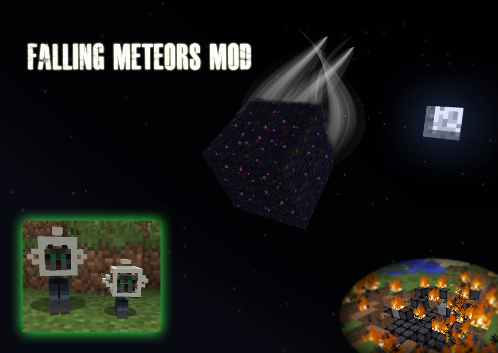
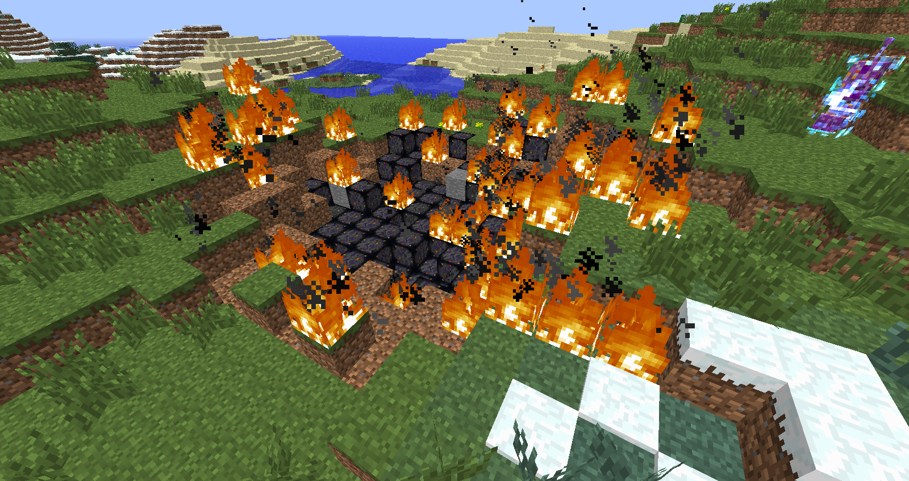
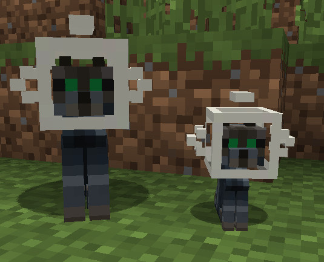

# Falling Meteors Mod



**Falling Meteors, continued for modern Minecraft by [blueDev](https://www.curseforge.com/members/bluedev/projects).**
The original mod was made by **AlexDGr8r** and stopped at Minecraft 1.7.10. This is its continuation, made with the original author's blessing, starting with **Forge 1.20.1**.



The Falling Meteors mod adds 5 different types of meteors that fall naturally down upon your world. Within the remains of these meteors holds incredibly powerful ores that can be used to create different tools, armor, and weapons with their own special abilities. Befriend a Comet Kitty, summon a meteor, magnetically attract items, and much more!

## Key Features

- Meteors Fall Randomly
- Tools, armor, and weapons created from the meteors' remains
- New Entities: Alien Creeper, Comet Kitty
- Protect your land from Meteors with a Meteor Shield that can be upgraded to cover more land
- Summon Meteors with the summoners
- Track Meteors with the Detectors and Timer Block
- Magnetically attract items with Meteorite Tools and Armor
- Walk on and control the water with Frezarite Tools and Armor
- Be completely immune to fire with Kreknorite Armor and Sword



## Downloads

Every file is on the [Releases](https://github.com/hadryphern/MeteorMod/releases) page. Releases are named by mod loader, then Minecraft version.

| Loader | Minecraft | Status |
|---|---|---|
| **Forge** | 1.20.1 | [Download](https://github.com/hadryphern/MeteorMod/releases/tag/forge-1.20.1-v2.15.0) (requires Forge 47) |
| **Fabric** | — | Coming later |

To install, put the `.jar` in your `mods` folder. It's needed on the server and on every client.

## More Information

- [Official Forum Thread](http://www.minecraftforum.net/topic/989113-164sspsmpfalling-meteors-modv2112/)
- [Official Wiki](http://fallingmeteorsmod.wikia.com/wiki/Falling_Meteors_Mod_Wiki)
- [Github Repository](https://github.com/AlexDGr8r/MeteorsMod) (original 1.7.10 source)
- [Original CurseForge page](https://www.curseforge.com/minecraft/mc-mods/falling-meteors-mod)

## Credits

**Original creators.** All credit for the mod, its ideas, art and sounds goes to them:

- **AlexDGr8r**: creator of Falling Meteors (code and textures)
  - [CurseForge](https://www.curseforge.com/members/alexdgr8r)
  - [GitHub](https://github.com/AlexDGr8r)
  - Original project: [Falling Meteors on CurseForge](https://www.curseforge.com/minecraft/mc-mods/falling-meteors-mod) (you can support AlexDGr8r with the donate button there)
- **Firecat1311** and **SLuRsniper24**: additional textures

**Continuation for modern Minecraft:**

- **blueDev**: 1.20.1 version and future versions
  - [CurseForge projects](https://www.curseforge.com/members/bluedev/projects)
  - [GitHub](https://github.com/hadryphern)

## Commands (op level 2)

| Command | What it does |
|---|---|
| `/meteor <x y z> <size> [delay] [type] [summoned]` | Spawns a meteor. Types: 0 Meteorite, 1 Frezarite, 2 Kreknorite, 3 Unknown, 4 Kitty |
| `/comet <x y z> [type] [delay]` | Spawns a comet |
| `/listMeteors [clear]` | Lists the meteors in orbit in this dimension |
| `/listShields` | Lists the Meteor Shields in this dimension |
| `/kittyattack` | Starts a Comet Kitty shower |

Game rules: `meteorsFall`, `summonMeteors`.

## Configuration

`<world>/serverconfig/meteors-server.toml` holds every option of the original mod, including:

- the fall radius around players
- which meteor types are enabled
- meteor sizes
- the Meteor Shield radius
- the explosion size
- how often meteors fall (deterrence)
- the dimensions where meteors fall

The server sends it to every client.

## What changed from 1.7.10

The gameplay is the same as the original. Some things had to change because Minecraft itself changed:

- **Items and blocks:**
  - Each Meteor Summoner and each storage block is now its own item.
  - Hot and cooled meteor blocks are block states.
  - Ore Dictionary names became Forge tags (`forge:ingots/meteorite`, `forge:ores/frezarite`, ...).
- **Achievements** are now advancements.
- **Comet Kitty:** it's based on the cat, since ocelots can no longer be tamed.
- **Not included:** the Baubles, Waila and Thaumcraft integrations, since those mods don't exist on 1.20.1.

## Building from source

Requires JDK 17.

```
./gradlew build          # mod jar in build/libs
./gradlew runClient      # test client
./gradlew runServer      # test server
```

Falling Meteors and its assets belong to their original creators and are used with permission.
